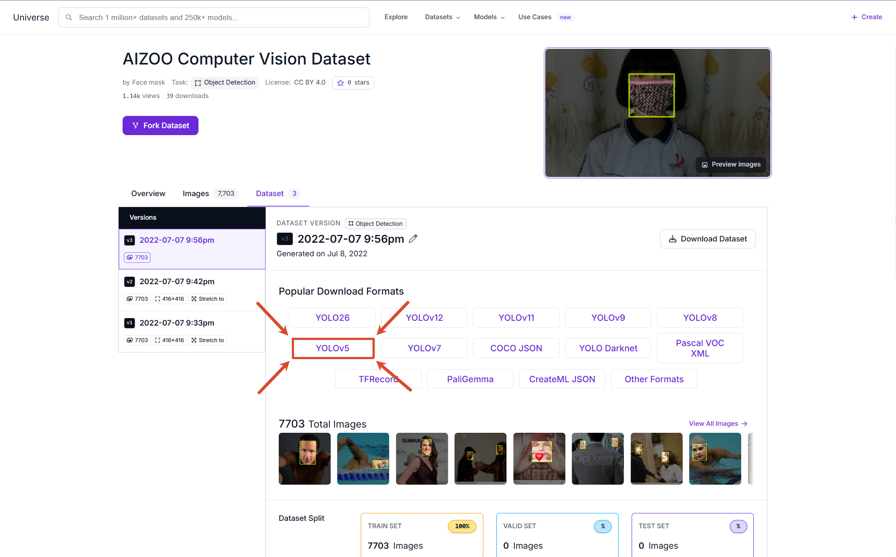
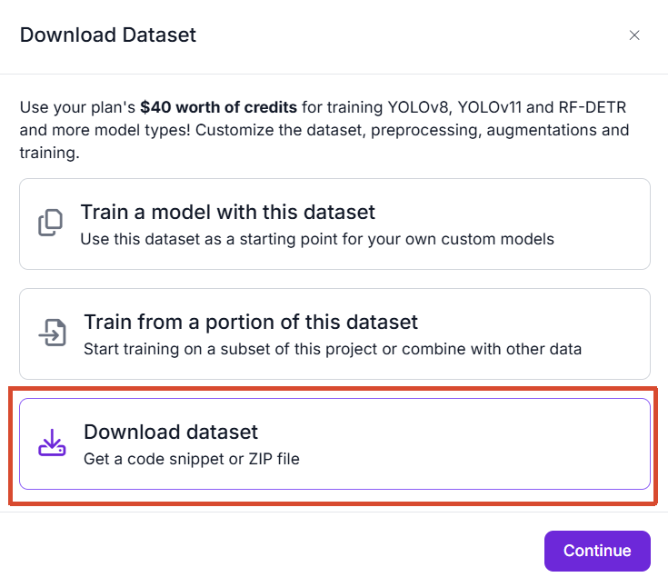
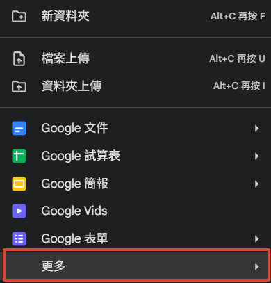
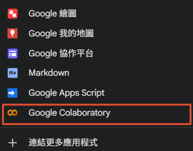
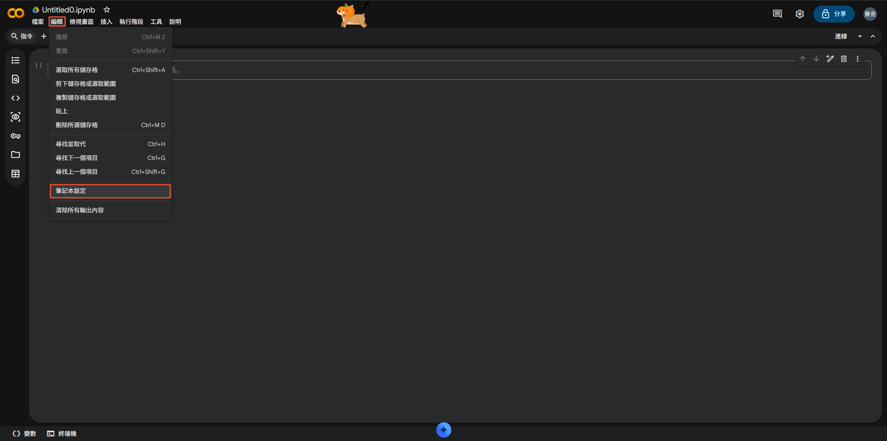
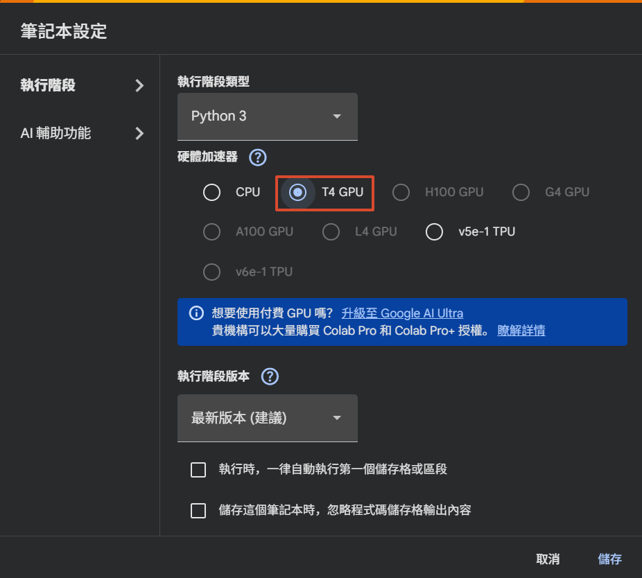
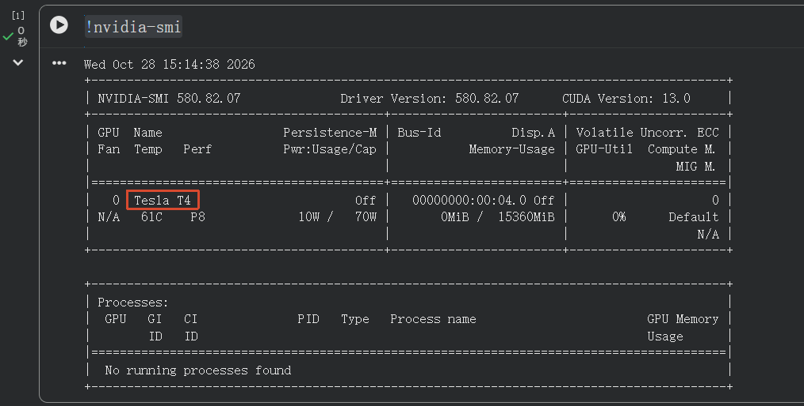

# Colab——訓練YOLO-v5

### 本專案旨在訓練[YOLOv5](https://github.com/ultralytics/yolov5)用於檢測是否配戴口罩


### Step 1：事前準備
- 下載並解壓縮用於訓練模型的資料集
  
  資料集來源：[AIZOO Computer Vision Dataset](https://universe.roboflow.com/face-mask-7jfbz/aizoo-kmme2/dataset/3/download/yolov5pytorch) (需註冊帳號才能下載)

  進入後按`YOLOv5` ➔ `Download dataset`
  <p align="center">
    
    &nbsp;&nbsp;&nbsp;
    
  </p>

  
- 進入[Google Drive](https://drive.google.com/) ➔ 上傳剛才下載並解壓縮後的資料夾 ➔ 按下左上角的"新增"

  
- 按"更多" ➔ "Google Colaboratory"

  <p align="center">
    
    &nbsp;&nbsp;&nbsp;
    
  </p>

***
### Step 2：Google Colaboratory設定
- 按下"編輯" ➔ "筆記本設定"
  
  

- 將"硬體加速器"從`CPU`改為`T4 GPU`並按下"儲存"
  
  

- 在"程式碼儲存格"輸入```!nvidia-smi```檢查是否成功切換為`T4 GPU`
  
  
***

### Step 3：程式碼實作
- 新增**第一個**"程式碼儲存格"接著輸入：
  ```python
  import os
  from google.colab import drive
  drive.mount('/content/drive')
  %cd /content/drive/MyDrive/
  ```
  作用：執行掛載指令，連接個人的 Google Drive 並映射及切換到 Colab 虛擬機的 `/content/drive` 目錄下，
  
- 新增**第二個**"程式碼儲存格"接著輸入：
  ```python
  !git clone https://github.com/ultralytics/yolov5.git
  %cd yolov5
  !pip install -r requirements.txt
  ```
  作用：`clone` YOLOv5 的儲存庫至 Google Drive 並切換至該資料夾下開始安裝依賴項
  
- 新增**第三個**"程式碼儲存格"接著輸入：
  ```python
  !python /content/drive/MyDrive/yolov5/train.py --img 640 --batch -1 --epochs 50 --data /content/drive/MyDrive/app/AIZOO-3/data.yaml --weights yolov5s.pt
  ```
  作用：執行 YOLOv5 物件檢測模型的訓練流程，它透過呼叫儲存在 Google Drive 中的 train.py 腳本，載入 yolov5s.pt 預訓練權重與 data.yaml 資料集設定，進行 50 個 Epoch 的模型微調訓練。

  備註：本次使用YOLOv5 Small模型，可參考下方表格並依需求更改

  ### YOLOv5 模型規格對比

  | 模型 | 規模 | 參數量 | 權重大小 | 適用場景 |
  | :--- | :--- | :--- | :--- | :--- |
  | **YOLOv5n** | Nano | ~1.9M | ~3.8 MB | 邊緣設備（如 Raspberry Pi、手機）、極低延遲需求 |
  | **YOLOv5s** | Small | ~7.2M | ~14.0 MB | 實時檢測、訓練速度快，適合初步驗證與開發 |
  | **YOLOv5m** | Medium | ~21.2M | ~40.8 MB | 精確度與推理速度平衡的最佳選擇 |
  | **YOLOv5l** | Large | ~46.5M | ~89.3 MB | 高精確度需求、計算資源充足的伺服器 |
  | **YOLOv5x** | XLarge | ~86.7M | ~166.0 MB | 追求 mAP 精確度，不在意運算資源 |
